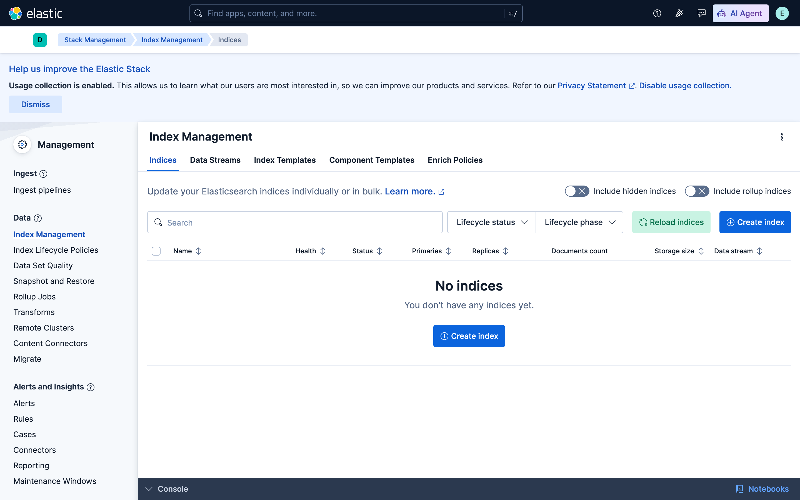
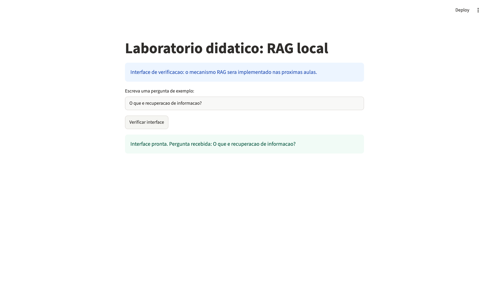

# Relatório — Preparação do Laboratório de RAG Local

**Disciplina:** Inteligência Artificial — IFPR União da Vitória
**Aluno:** Vinicius Gabriel Todis
**Data:** ___/___/2026

---

## 1. Checklist de infraestrutura (seção 14.1)

- [ ] Sistema operacional identificado
- [ ] CPU, RAM e espaço em disco conferidos
- [ ] Python 3 instalado e versão registrada
- [ ] VS Code e extensão Python instalados
- [x] WSL 2 funcional — *não se aplica (macOS)*
- [ ] Docker e Compose testados
- [ ] `vm.max_map_count` adequado
- [ ] Ollama disponível
- [ ] `.venv` criado
- [ ] Bibliotecas do `requirements.txt` instaladas
- [ ] `.env` gerado e protegido
- [ ] Elasticsearch inicializado
- [ ] Kibana conectado e acessível
- [ ] Modelo Qwen3 baixado e testado
- [ ] EmbeddingGemma baixado e testado
- [ ] Aplicação Streamlit aberta
- [ ] Versões registradas
- [ ] Contêineres encerrados sem apagar volumes

## 2. Evidências (seção 14.2)

Arquivos gerados por `scripts/coletar_evidencias.py`, exceto as capturas de tela.

| # | Evidência | Arquivo |
|---|---|---|
| 1 | Identificação da estação (SO, Python, RAM, disco, arquitetura) | [`evidencias/01_estacao.txt`](evidencias/01_estacao.txt) |
| 2 | `docker compose ps` | [`evidencias/02_docker_compose_ps.txt`](evidencias/02_docker_compose_ps.txt) |
| 2 | Kibana autenticado (sem senha visível) |  |
| 3 | `scripts/validar_ambiente.py` | [`evidencias/03_validar_ambiente.txt`](evidencias/03_validar_ambiente.txt) |
| 4 | `scripts/testar_modelos.py` (resposta + dimensão do embedding) | [`evidencias/04_testar_modelos.txt`](evidencias/04_testar_modelos.txt) |
| 5 | Streamlit em http://127.0.0.1:8501 |  |
| 6 | `versoes-instaladas.txt` | [`versoes-instaladas.txt`](versoes-instaladas.txt) |

**Estação utilizada:** MacBook com Apple Silicon (arm64), macOS. O manual descreve Windows e Linux;
as adaptações para macOS estão no [README](README.md#passo-a-passo-no-macos-apple-silicon).

### 7. Dificuldades encontradas e resolução

| Problema | Diagnóstico | Resolução |
|---|---|---|
| Manual sem roteiro para macOS | Passos W3 (WSL) e L4 (sudo/grupo docker) não se aplicam | Docker Desktop for Mac, sem `sudo`; Ollama pelo instalador oficial |
| _(preencher)_ | | |

---

## 3. Atividades de reflexão (seção 15)

**1. Por que é recomendável criar um `.venv` para cada projeto Python? Como comprovar qual interpretador está ativo?**

Cada projeto tem suas próprias versões de bibliotecas. Instalando tudo no Python global, um projeto
pode quebrar outro (ex.: um exige `pandas` 2, outro `pandas` 1) e ainda se altera o Python do
sistema operacional, o que o Linux inclusive bloqueia (`externally-managed-environment`). O `.venv`
isola as dependências, torna a instalação reproduzível a partir do `requirements.txt` e pode ser
apagado e recriado sem afetar nada. Para comprovar o interpretador ativo:
`python -c "import sys; print(sys.executable)"` — o caminho deve terminar em `.venv/bin/python`
(ou `.venv\Scripts\python.exe`). Também é possível conferir com `pip -V` e na barra de status do VS Code.

**2. Qual é a diferença entre a instalação do Ollama e a instalação da biblioteca Python `ollama`?**

O Ollama (programa) é o **servidor de inferência**: carrega os modelos na memória, executa-os e
expõe uma API HTTP em `127.0.0.1:11434`. É instalado no sistema operacional. A biblioteca Python
`ollama` é apenas um **cliente**: instalada no `.venv` via pip, ela monta as requisições HTTP para
esse servidor. Sem o serviço rodando, a biblioteca importa normalmente, mas falha com
"conexão recusada"; sem a biblioteca, o serviço funciona pelo terminal (`ollama run`), mas o
código Python não consegue chamá-lo de forma simples.

**3. Por que o Elasticsearch precisa armazenar dados em volumes persistentes?**

Contêineres são descartáveis: `docker compose down` remove o contêiner e tudo o que estava no
sistema de arquivos dele. Os índices, os documentos indexados, os vetores e os usuários/senhas
(como a senha do `kibana_system`) ficam em `/usr/share/elasticsearch/data`. Montando esse diretório
no volume nomeado `esdata`, os dados sobrevivem à recriação e à atualização do contêiner, e não é
preciso reindexar os documentos a cada aula. Por isso não se usa `down -v` por rotina e não se
regenera o `.env` com o volume já criado (a senha antiga continua gravada no volume).

**4. O que significa publicar um serviço em `127.0.0.1`? Em que situação essa configuração seria insuficiente?**

`127.0.0.1` é a interface de loopback: a porta só aceita conexões vindas do próprio computador, e
outras máquinas da rede do campus não alcançam o Elasticsearch (9200) ou o Kibana (5601). Isso
reduz a superfície de ataque, permitindo HTTP sem TLS no laboratório. É insuficiente quando: o
serviço precisa ser acessado por outras máquinas (servidor compartilhado da turma, aplicação em
produção, API consumida por outra equipe); o computador é multiusuário, já que qualquer processo
ou conta local ainda alcança o loopback; ou os dados são sensíveis. Nesses casos são necessários
TLS, autenticação e autorização por usuário, firewall/proxy reverso e gestão segura de segredos.

**5. Qual é o risco de adicionar indiscriminadamente estudantes ao grupo `docker` no GNU/Linux?**

O daemon do Docker roda como root, e quem pertence ao grupo `docker` pode controlá-lo. Isso é
equivalente a ter acesso root: basta um `docker run -v /:/host -it alpine chroot /host` para ler e
alterar qualquer arquivo da máquina (senhas em `/etc/shadow`, arquivos de outros alunos), instalar
programas ou desativar controles, sem passar pelo `sudo` nem deixar registro nele. Em computador
compartilhado, isso quebra o isolamento entre usuários. As alternativas são `sudo` controlado pela
TI ou Docker em modo rootless.

**6. Por que uma resposta gerada por `qwen3:1.7b`, sem documentos recuperados, ainda não constitui um RAG?**

RAG é *Retrieval-Augmented Generation*: a geração precisa ser **aumentada por uma recuperação**. No
teste, o modelo responde apenas com o que memorizou no treinamento: não há busca no Elasticsearch,
nenhum trecho de documento entra no prompt e não é possível indicar fonte ou página. Assim, a
resposta pode estar desatualizada ou ser inventada (alucinação), e não há como verificá-la. Um RAG
exige: indexar os documentos, recuperar os trechos relevantes para a pergunta, inseri-los como
contexto no prompt e gerar uma resposta fundamentada nesses trechos, citando as fontes ou
admitindo quando não há evidência.

**7. Qual é a diferença entre vetores produzidos por `embeddinggemma` e respostas em linguagem natural geradas por Qwen3?**

O `embeddinggemma` transforma um texto em um **vetor de números de dimensão fixa** (o
`testar_modelos.py` mostra a dimensão retornada) que representa seu significado: textos com
sentidos parecidos geram vetores próximos (similaridade de cosseno). Esses vetores não são lidos
por humanos; servem para **comparar e buscar** (busca semântica no Elasticsearch). O Qwen3 é um
modelo **generativo**: recebe texto e produz texto novo, token a token, para uma pessoa ler. No RAG,
os dois têm papéis complementares: o embedding encontra os trechos; o LLM redige a resposta a
partir deles. Além disso, o embedding de um mesmo texto é determinístico, enquanto a geração pode
variar a cada execução.

**8. Como o docente pode avaliar se duas estações estão reproduzindo o mesmo experimento, mesmo que seus resultados textuais não sejam idênticos?**

Comparando o **ambiente** e **resultados mensuráveis**, e não o texto livre do LLM, que é
naturalmente variável. Ambiente: mesmas versões (`versoes-instaladas.txt`, versão do Python,
imagens Elastic 9.5.6, `ollama list` com os mesmos modelos e digests), mesmo `compose.yaml` e mesmos
parâmetros (`num_ctx`, `num_predict`, temperatura). Resultados: mesma dimensão de embedding,
vetores do mesmo texto praticamente iguais (similaridade ≈ 1), mesma lista de trechos recuperados
para um conjunto fixo de perguntas e métricas de recuperação equivalentes (precisão@k, recall@k,
MRR). Na geração, avalia-se com critérios: a resposta usa os trechos fornecidos, cita as páginas
corretas e admite a falta de evidência? Para reduzir a variação, pode-se fixar `temperature=0` e
`seed`. Testes automatizados com `pytest` podem checar esses pontos objetivamente.
